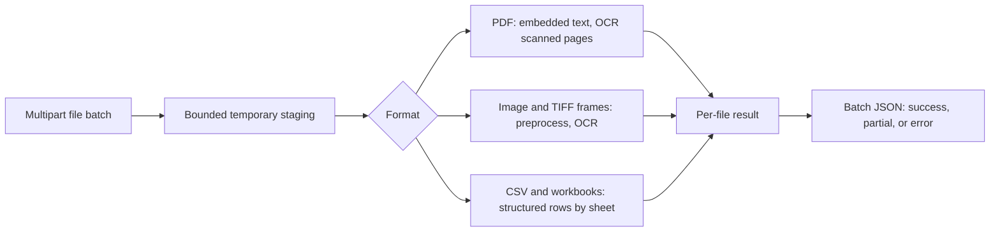

# Document Ingestion API

**Live app:** [document-ingestor.vercel.app](https://document-ingestor.vercel.app/)

A batch upload service for PDF, JPG/JPEG, PNG, TIFF, XLSX, XLS, and CSV files. Each file produces its own result, so a damaged file or an OCR failure does not discard the rest of a batch.

## Processing design

- PDFs are opened page by page. Pages with enough embedded text use direct extraction; pages that appear scanned are rendered at up to 300 DPI and OCRed.
- Images are verified before processing. TIFF frames are treated as separate pages.
- OCR converts to grayscale, increases contrast and sharpness, then compares adaptive threshold and grayscale passes under two Tesseract page layouts. The best confidence transcription is returned.
- XLSX and XLS workbooks return one row array per sheet. Date cells become ISO strings. Formula cells return a cached value when present and otherwise the formula text.
- CSV uses delimiter sniffing and tries UTF-8, UTF-16, and Windows-1252 decoding.
- Every document result has success, partial, or error status. Page-level warnings and file-level error codes are returned in the JSON response.
- Uploads are streamed to request-scoped temporary storage and deleted after processing. CPU-heavy extraction runs in worker threads with a concurrency limit.

## Run locally

Use Python 3.10 or newer. OCR requires the Tesseract executable and the language data for the requested language.

On Windows, extract the ZIP and double-click `run.bat`. It creates the virtual environment, installs the Python dependencies, reports whether OCR is ready, and starts the browser workspace. Open the URL printed in the terminal (by default http://127.0.0.1:8000/). Keep that terminal open while using the app.

For a manual setup:

    python -m venv .venv
    .\.venv\Scripts\Activate.ps1
    python -m pip install -r requirements.txt
    uvicorn app:app --reload

OCR needs both the Python `pytesseract` package (included in `requirements.txt`) and the separate Tesseract OCR engine. On Windows, install Tesseract OCR; the app checks PATH and the standard Program Files locations automatically. If it is installed elsewhere, set `TESSERACT_CMD` to the full path of `tesseract.exe`, for example `C:\Program Files\Tesseract-OCR\tesseract.exe`. The browser workspace shows whether OCR is ready, and `GET /health/ocr` reports the engine version or a setup message. On Debian/Ubuntu, install `tesseract-ocr` and the language package, for example `tesseract-ocr-eng`.

## Run with Docker

    docker build -t document-ingestor .
    docker run --rm -p 8000:8000 document-ingestor

## Deploy to Vercel

The root `Dockerfile.vercel` configures a Vercel container function and installs Tesseract, so scanned PDFs and images can use OCR. Vercel routes the app through the container image, and the app applies its smaller cloud limits automatically. The regular `Dockerfile` remains available for local Docker use.

Vercel Functions cap request and response bodies at 4.5 MB. The cloud profile therefore limits uploads to 3 MiB per file and 4 MiB per batch, PDFs to 10 pages, images to 10 frames, and each spreadsheet to 20,000 cells. These cloud limits are separate from the larger local limits. Vercel's local filesystem is temporary: the cloud results library can reset when an instance is replaced. Use the local app for durable result history until a persistent database is connected.

## Interface

Open http://localhost:8000 for the browser upload workspace. Select files or drop them onto the upload area, run extraction, then review per-page text and spreadsheet previews. The interface can copy extracted content, download the full response as JSON, and search/filter saved results. The local SQLite library stores extracted results only; original uploads are removed after processing. Delete results from the interface or the API. Swagger documentation remains available at http://localhost:8000/docs.

## API

GET /health returns a simple service status.

GET /health/ocr reports OCR availability and the detected Tesseract version.

GET /documents searches the local saved-results library. It accepts `q`, `file_type`, `limit`, and `offset` query parameters. `GET /documents/{id}` returns one full saved extraction; `DELETE /documents/{id}` removes that result.

POST /ingest accepts multipart form uploads. Send one or more files using the repeated form field name files:

    curl -X POST http://localhost:8000/ingest -F "files=@scan.pdf" -F "files=@report.xlsx" -F "files=@photo.tif"

The response contains a summary and one result per file. A PDF result uses pages with page number, extraction method, text, and optional OCR confidence. A spreadsheet or CSV result uses sheets with name, row and column counts, and row arrays. Error results include a stable code and readable message.

## Limits and configuration

Defaults protect the service from very large uploads and pathological workbooks. Override with environment variables:

- MAX_UPLOAD_BYTES: 50 MiB per file.
- MAX_BATCH_BYTES: 200 MiB per request.
- MAX_FILES_PER_REQUEST: 20.
- MAX_PARALLEL_EXTRACTIONS: 2 OCR/extraction jobs at a time.
- MAX_PDF_PAGES and MAX_IMAGE_FRAMES: 500 each.
- MAX_OCR_PIXELS: 40 million.
- MAX_TABLE_CELLS: 200,000 across each workbook or CSV.
- MAX_TABLE_ROWS: 50,000 across each workbook or CSV; MAX_TABLE_COLUMNS: 500; MAX_SHEETS: 100.
- MAX_UNCOMPRESSED_XLSX_BYTES: 500 MiB after ZIP expansion.
- INGEST_TEMP_DIR: optional writable staging directory; defaults to work/tmp inside the project.
- INGEST_DB_PATH: optional SQLite path for the saved-results library; defaults to work/documents.sqlite3 inside the project.
- TESSERACT_CMD: optional full path to `tesseract.exe` when the executable is not on PATH or in a standard Windows install location.
- TESSERACT_LANG: eng by default; configure installed language codes such as eng+fra.

Vercel uses lower upload, page, and spreadsheet limits to stay within its function payload and execution constraints. The browser workspace reads those limits from `/health` and displays the cloud storage behavior.

For a scanned PDF, OCR is triggered page by page only where embedded text is missing or too sparse. If Tesseract is unavailable, digital pages still extract and scan pages return partial results with warnings. Corrupt or unsupported files return an error object without stopping other files in the request.

